# Kyanos Programming Language (KyanosLang)

Kyanos is a modern statically typed systems programming language designed to combine high developer productivity with native execution performance.  
Built on top of LLVM, it features powerful bidirectional type inference, intuitive TypeScript-like syntax, safe and deterministic memory management via Nim-inspired ORC (Optimistic Reference Counting), and zero-cost abstractions.

---

## 📁 Repository Structure

The repository adopts a modular hierarchy aligned with standard compiler projects (such as `rust-lang/rust`) for maintainability and future self-hosting.

```mermaid
graph TD
    Root["KyanosLang (Root)"]
    
    Compiler["compiler/ (Rust Stage 0 Bootstrap Compiler)"]
    Library["library/ (Kyanos Standard Library)"]
    Src["src/ (Tooling & Ecosystem)"]
    Tests["tests/ (Integration Test Suite)"]
    Design["design/ (Language Specifications)"]
    Docs["docs/ (Documentation)"]
    
    Root --> Compiler
    Root --> Library
    Root --> Src
    Root --> Tests
    Root --> Design
    Root --> Docs
    
    Compiler --> C_Lexer["kyanos_lexer (Lexical Analysis)"]
    Compiler --> C_Parse["kyanos_parse (Syntax Parsing)"]
    Compiler --> C_AST["kyanos_ast (Abstract Syntax Tree)"]
    Compiler --> C_Sema["kyanos_sema (Semantic Analysis & Type Inference)"]
    Compiler --> C_Codegen["kyanos_codegen_llvm (LLVM IR Codegen)"]
    Compiler --> C_Driver["kyanos_driver (CLI Driver & Entrypoint)"]
    
    Library --> L_Core["core (Primitives & Minimal Runtime)"]
    Library --> L_Std["std (Standard Library)"]
```



| Directory | Description |
| :--- | :--- |
| [`compiler/`](./compiler) | **Rust Stage 0 Bootstrap Compiler**<br>Organized as a workspace following the "Compiler as a Library" principle, separating lexing, parsing, AST, sema, and codegen into independent crates. |
| [`library/`](./library) | **Standard Library written in Kyanos (`.ky`)**<br>Contains `core` (primitives and minimal runtime) and `std` (collections, I/O, etc.). |
| [`src/`](./src) | **Tooling & Ecosystem**<br>REPL, LSP (Language Server), formatter, package manager, and CLI utilities. |
| [`tests/`](./tests) | **Test Suite**<br>Unit tests, integration tests, compile-fail tests, and snapshot tests. |
| [`design/`](./design) | **Language Design & Specifications**<br>Grammar definitions, type system, memory model, FFI, and tooling architecture documents. |
| [`docs/`](./docs) | **Official Documentation & Guides**<br>Tutorials, user guides, and language reference manuals. |

---

## 📚 Design Specifications

Refer to [`design/`](./design) for comprehensive specifications and design documents:

* [Language Design Document (`design/design.md`)](./design/design.md) - Overall language syntax, type system, ORC memory model, and concurrency.
* [ANTLR v4 Formal Grammar (`design/grammer/`)](./design/grammer) - Authoritative lexical (`kyanos_lex_grammar.g4`) and syntactic (`kyanos_syntax_grammar.g4`) grammar definitions.
* [Bidirectional Type Inference Specification (`design/design_type_inference.md`)](./design/design_type_inference.md) - Local type inference, contextual typing, reverse inference, and `double` fallback.
* [C-FFI Specification (`design/design_ffi.md`)](./design/design_ffi.md) - Foreign Function Interface, C-ABI compatibility, and raw pointers.
* [Tooling & Ecosystem Architecture (`design/design_tool.md`)](./design/design_tool.md) - Compiler architecture, LLVM ORC JIT (REPL), LSP server, CLI, and MCP server.
* [Object Literal Interpretation (`design/design_dictionaries_type.md`)](./design/design_dictionaries_type.md) - Anonymous structs vs. dictionary types.

---

## 🛠️ Building & Testing (Stage 0)

Prerequisites:
* Rust toolchain (2021 edition)
* LLVM (for backend code generation)

```bash
# Check syntax and type check across crates
cargo check --workspace

# Run test suites
cargo test --workspace

# Build the compiler binary (kyanos CLI)
cargo build --package kyanos_driver

# Build optimized release binary
cargo build --release
```

---

## 🗺️ Roadmap

1. **Stage 0: Bootstrap Compiler in Rust**
   - [x] Initial language architecture and grammar specifications
   - [ ] Lexer (`kyanos_lexer`) and handcrafted parser (`kyanos_parse`)
   - [ ] Semantic analyzer and bidirectional type inference (`kyanos_sema`)
   - [ ] LLVM IR codegen (`kyanos_codegen_llvm`) and C-FFI
   - [ ] Unified CLI driver (`kyanos_driver`)
2. **Stage 1: Self-Hosting in Kyanos**
   - Implement the Kyanos compiler in Kyanos itself and compile with the Stage 0 compiler
3. **Stage 2: Full Bootstrap Verification**
   - Compile the Stage 1 compiler using itself to generate Stage 2 and verify identical binary outputs

---

## 📄 License(Planned)

* Mozilla Public License 2.0