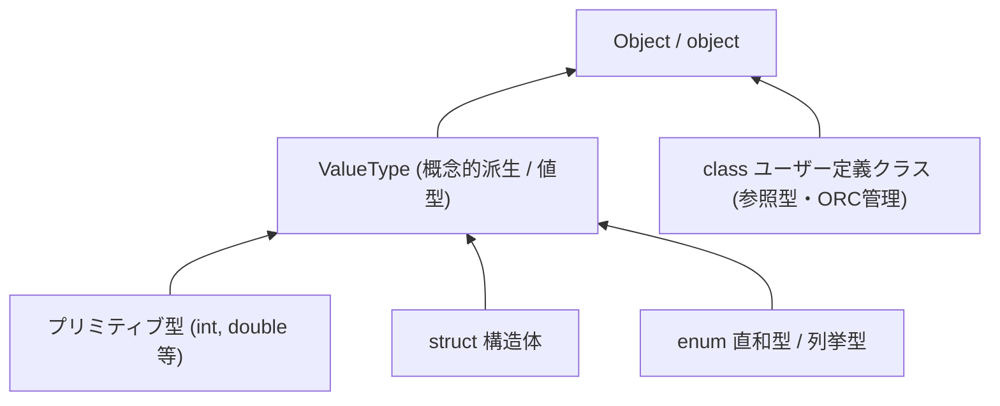
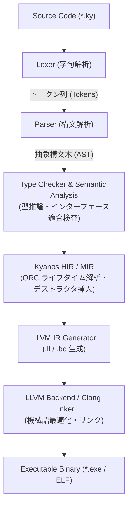

# Kyanos 言語設計仕様書 (Language Design Document)

## 1. 概要 (Overview)

| 項目               | 内容                                                                                   |
| :----------------- | :------------------------------------------------------------------------------------- |
| **言語名**         | Kyanos (キュアノス)                                                                    |
| **リポジトリ名**   | `kyanos-lang`                                                                          |
| **主要ターゲット** | システムズプログラミング、CLIツール、ゲームエンジン・組み込み、高スループットサーバー  |
| **コンパイラ方式** | AOTコンパイラ (LLVM IR 直接生成によるネイティブバイナリ出力)                           |
| **型システム**     | ハイブリッド方式 (公称型 class/struct + 構造的 interface) ＋ 静的型推論                |
| **メモリ管理**     | Nim風 ORC (スレッド局所・非アトミック高速ARC + 循環参照コレクタ, STW GC無し)            |
| **構文スタイル**   | TypeScript 風の親しみやすく表現力の高い構文 (`async`/`await` 統合)                      |
| **主な特徴**       | スクリプト感覚で書ける低レベルプログラミング (生ポインタ、C-FFI、決定論的解放、並列処理) |

---

## 2. 設計思想 & コンセプト (Core Philosophy)

1. **TypeScriptの書き味 × C/Rustの実行性能**:
   - Web開発者にも馴染み深い `let` / `const` / `class` / アロー関数 / インターフェース構文を採用。
   - 実行時はLLVMによる高度な最適化を受け、C/C++に匹敵するネイティブコードとして動作。
2. **Stop-The-World (STW) GC の排除**:
   - 大規模なガベージコレクションによる一時停止を排除し、予測可能なレイテンシと決定論的なメモリ解放を実現。
   - Nimの ORC アプローチ（ムーブセマンティクス＋ARC＋循環参照コレクタ）を採用。
3. **日常の `class` と低レベルの `struct` (C#/Swift 思想)**:
   - 日常のオブジェクト指向・ビジネスロジックは TypeScript 風の `class`（ORC管理参照型）で記述。
   - メモリ配置が厳密なバッファやC言語連携、ゼロコストなデータ構造には `struct`（スタック値型）を使用。
4. **純粋なクラスベース オブジェクト指向 (プロトタイプベースの完全排除)**:
   - TypeScript/ES6の `class` 構文のみを採用し、JavaScript伝統のプロトタイプチェーン (`prototype`, `__proto__`) やコンストラクタ関数によるインスタンス化を完全に排除。
   - AOTコンパイラに最適化された静的なメモリレイアウトと仮想関数テーブル (vtable) により、オーバーヘッドのない高速なフィールドアクセスとメソッド呼び出しを実現。
5. **ES Modules スタイルのモジュール設計 (`namespace` の排除)**:
   - TypeScriptのレガシーな `namespace`（内部モジュール）は非対応。
   - 1ファイル＝1モジュールを基本とし、標準的な `import` / `export` 構文でファイル間連携を行う。
   - 依存関係が静的に解決されるため、シンボルの名前衝突を防ぎ、コンパイル時のデッドコード除去（Tree Shaking）が容易。
6. **明示的でゼロコストなエラーハンドリング (`Result<T, E>` + `try` 式)**:
   - C++風の例外巻き戻し（Stack Unwind）を排除し、型安全な判別共用体 `Result<T, E>`（`Ok` / `Err`）による戻り値ベースのエラー処理を採用。
   - エラー伝播には新記号を増やさず、既存キーワード `try` 式（`let val = try expr;`）を使用。`?`（オプショナル型やチェーン）との記号衝突を防ぐ。
7. **`switch` の近代化とパターンマッチング (`when` ガード)**:
   - 新キーワード `match` は導入せず、馴染み深い `switch` / `case` をパターンマッチング可能に拡張。
   - C言語由来の暗黙のフォールスルーを廃止し、自動 break とする。
   - 文（Statement）と式（Expression）の両方に対応し、ガード節には C# や TC39 提案と親和性の高い `when` キーワードを採用。
8. **第一級の非同期・並行処理 (`async`/`await` + `spawn` + `Channel`)**:
   - 高スループットな非同期I/O処理のために、TypeScript風のスタックレスコルーチン `async` / `await` を最初から標準装備。
   - マルチコア並列計算には、スレッドプールへタスクを投入して `Promise<T>` を返す `spawn()` を採用。
   - スレッド間の安全な協調には、データ競合（Data Race）を根本から排除する所有権ムーブ方式の `Channel<T>` を提供。

---

## 3. 型システム (Type System)

### 3.1 ハイブリッド型付け (Hybrid Typing)

* **クラス (`class`) — 公称型 (Nominal Typing) & 参照型 (Heap / ORC)**:
  - ES6/TypeScript と同様に `class` 構文で定義し、`new` で生成、参照として受け渡す。
  - **プロトタイプベースの完全排除**: JavaScriptのプロトタイプ継承や実行時の動的プロパティ追加・モンキーパッチは採用せず、静的なクラス継承 (`extends`) および vtable ディスパッチを採用。
  - **アクセス修飾子 (TypeScript準拠)**:
    - **なし (デフォルト)** / **`public`**: どこからでもアクセス可能。
    - **`protected`**: 定義クラス内およびサブクラス（派生クラス）からアクセス可能。
    - **`private`** / **`#識別子`**: 定義クラス内からのみアクセス可能。
  - メモリはヒープに確保され、Nim風 ORC (ARC + Cycle Collector) により自動管理。
* **構造体 (`struct`) — 公称型 (Nominal Typing) & 値型 (Stack / C-ABI)**:
  - スタック上にインライン展開され、コピーまたはムーブセマンティクスで動作。
  - メモリレイアウトが静的に確定し、C言語の `struct` と1:1のバイナリ互換性を持つ。
  - **メソッド定義と静的直接呼び出し (Zero-cost Direct Call)**:
    - メソッド、コンストラクタ（`constructor`）、静的メソッドを定義可能。
    - vtable を介さずコンパイル時に直接呼び出し（Direct Call）へ解決され、インライン展開されるためオーバーヘッドは完全にゼロ。
  - **フィールド変更の静的検査 (キーワード不要)**:
    - メソッド内で自身のフィールドを変更する場合、コンパイラが静的に自動検知。
    - `const` で宣言されたインスタンスから変更メソッドを呼び出すとコンパイルエラー（`let` で宣言された可変インスタンスからのみ呼び出し可能）。
  - **継承の禁止 (C# 方式)**:
    - `struct` の継承（`extends`）は禁止（構文エラー）。メモリの断片化やスライシングを防ぎ、再利用には合成（Composition）、多態性には `interface` 適合を用いる。
* **インターフェース (`interface`) — 構造的型付け (Structural Typing)**:
  - TypeScriptの Duck Typing と同様、要求する形状（プロパティ・メソッド）を満たしていれば、明示的な `implements` なしに `class` や `struct` を渡すことが可能。
  - **ディスパッチ方式とメモリモデル**:
    1. **静的単相化 (Monomorphization)**: ジェネリクス（`<T extends HasPosition>` 等）では具象型ごとに専用コードを直接インライン展開し、ボクシングなしの最高速（ゼロコスト）で実行。
    2. **動的ディスパッチ (Fat Pointer: データポインタ + vtable)**: インターフェース型の変数やコレクション要素として動的に受け渡す場合に使用。
    3. **値型の自動ボックス化 (Auto-Boxing / ORC管理)**: スタック上の値型（`struct` や匿名構造体）を動的インターフェース型に代入・変換する際、自動的にヒープへボックス化（ORC管理）される。これにより、インターフェースをクラスフィールドに保存したり関数から `return` した場合でも、スタック破棄によるダングリングポインタを原理的に防止。
       - *補足（ボックス化と変更操作）*: 動的インターフェース変数に対して状態変更メソッドを呼び出した場合、更新されるのはヒープ上のボックス化コピー側であり、元のスタック上の `struct` 変数は変更されない（C# の Boxing と同様の挙動）。元の `struct` をインプレースで書き換えたい場合は、ジェネリクスによる静的単相化と可変参照（例: `function update<T extends Movable>(target: &T)`）を使用する。

```typescript
// 1. 構造的型 (Structural): 形状に適合すればマッチ
interface HasPosition {
    x: double;
    y: double;
}

function printPosition(pos: HasPosition) {
    println(`Position: (${pos.x}, ${pos.y})`);
}

// 2. 構造体 (値型・スタック): HasPosition の形状を満たすため渡せる
struct Vector2 {
    x: double;
    y: double;
}
let v = Vector2 { x: 10.0, y: 20.0 };
printPosition(v);

// 3. クラス (参照型・ヒープ/ORC): こちらも HasPosition を満たせば渡せる
class Player {
    name: string;
    x: double;
    y: double;

    constructor(name: string, x: double, y: double) {
        this.name = name;
        this.x = x;
        this.y = y;
    }
}
let player = new Player("Hero", 0.0, 5.0);
printPosition(player);
```

### 3.2 統一型階層 (Unified Type Hierarchy - 単一の基底 Object)

C# (`System.Object`) や Ruby (`Object`) のように、すべての型が頂点にある単一の既定クラス **`Object`** (エイリアス: `object`) から派生する統一型システムを採用。



* **全クラスの暗黙継承**:
  - すべての `class` は、基底クラスが明示されない限り暗黙的に `Object` を継承する。
  - すべての型で共通の標準メソッド（`.toString()`, `.equals()`, `.hashCode()` など）が利用可能。
* **プリミティブ型・構造体の概念的継承と最適化**:
  - プリミティブ型や `struct` も概念上は `Object` の派生として扱われ、`42.toString()` のような直感的な記述が可能。
  - **実行時オーバーヘッドの排除 (Zero-cost Primitive Optimization)**:
    1. **非ボックス化 (Unboxed by default)**: 通常の計算・変数保持・引数渡しでは、ヒープ割り当てを行わず LLVM のネイティブスカラー（`i32`, `double` 等）としてレジスタ/スタック上で直接処理。
    2. **静的呼び出し解決 (Devirtualization)**: プリミティブに対する `.toString()` 等の呼び出しは、仮想関数テーブル (vtable) を経由せず、コンパイル時に専用の関数（例: `Int32_toString(val)`) へ直接解決・インライン化される。
    3. **必要時のみのボクシング (Boxing / Unboxing)**: 明示的に `let obj: Object = 100;` のように参照型の基底として扱われる場合のみ、ヒープ上に一時ボックス化（ORC管理）される。ジェネリクスでは静的単相化 (Monomorphization) を行うため、ボクシングなしで最高速動作する。

### 3.3 プリミティブ型一覧
プリミティブ型は C# 風の型名と Rust 風のエイリアス () 内のどちらでも定義可能。
- **整数型**: `byte(i8)`, `short(i16)`, `int(i32)`, `long(i64)`, `size_t(isize)` / `ubyte(u8)`, `ushort(u16)`, `uint(u32)`, `ulong(u64)`
- **浮動小数点数**: `float(f32)`, `double(f64)`
- **真偽値**: `bool` (`true`, `false`)
- **文字・文字列**: `char` (UTF-32/Unicode スカラー値: 4バイト), `string` (フレキシブル内部表現、ORC管理ヒープ文字列)
  - **フレキシブル文字列モデル (PEP 393 風)**:
    - 最大コードポイントに応じて、内部バッファを **1バイト幅 (ASCII/Latin-1)** / **2バイト幅 (UCS-2)** / **4バイト幅 (UCS-4/UTF-32)** のいずれかの固定長配列として保持。
    - **文字単位の $O(1)$ ランダムアクセス**: `str[i]` は文字幅に応じたオフセット（`i * width`）で即座にアクセスでき、戻り値は `char`。文字の途中で切れる不整合が原理的に発生しない。
    - **直感的な文字数管理**: `str.length` は文字（コードポイント）数を常に $O(1)$ で取得可能。
  - **C-FFI / 外部連携**:
    - C言語（`const char*`）や OS/ネットワークI/O（UTF-8 前提）と連携する際は、明示的な変換メソッド（`str.toUtf8(): ubyte[]`, `str.toCString(): CString` 等、ポインタ取得は `cStr.asPtr(): *const ubyte`）を利用。
- **低レベルポインタ**: `*T` (可変生ポインタ), `*const T` (不変生ポインタ), `rawptr` (Cの `void*`)
- **参照**: `&T` (可変参照), `&const T` (不変参照)
  - **`mut` キーワードの排除と `const` による統一**: ポインタ・参照ともに `mut` キーワードは設けず、`const` の有無（可変: `*T` / `&T`、不変: `*const T` / `&const T`）で一貫して表現する。
  - **用途**: 主に値型（`struct`, `T[N]`）を関数引数として渡す際のコピー回避（ゼロコスト参照渡し）および呼び出し元変数のインプレース更新に使用。
  - **呼び出し側構文（`&val` への統一）**: 参照渡し・アドレス取得の式は常に `&val` と記述する。`val` が `let`（可変変数）であれば `&T` / `*T` と `&const T` / `*const T` の両方に渡すことができ、`const`（不変変数）であれば不変の `&const T` / `*const T` にのみ渡せる（可変の `&T` / `*T` へ渡すとコンパイルエラー）。
  - **Second-class reference 規則**: スタックの安全性を保証するため、参照は関数引数およびローカルスコープに限定（関数の戻り値やクラス/構造体フィールドへの保持は禁止）。
- **空値**: `void`, `never`

### 3.4 列挙型・直和型とエラーハンドリング (Enums, Sum Types & Error Handling)

* **直和型としての `enum` (Swift / Rust スタイル)**:
  - 単純な数値列挙型だけでなく、ケースごとに関連データ（ペイロード）を持てる **代数的データ型（ADT / Tagged Union）** として定義。
  - **ゼロコスト値型 (Stack / Inline)**: スタック上に直接展開され、ヒープ割り当てはゼロ。内部メモリレイアウトは `[判別タグ (整数) + 最大ペイロード共用体]`。
  - **再帰的データ構造の扱い**: `enum Expr { Binary(Expr, Expr), ... }` のような直接の自己再帰は、型のサイズが無限大となりスタックサイズをコンパイル時に確定できないためコンパイルエラー。木構造やASTなどを表現する場合は、ヒープ確保される参照型（`class`、動的配列 `Expr[]`、またはヒープボックス型 `Box<T>`）を介してペイロードを保持する。
  - 単純な数値列挙（例: `enum HttpStatus { Ok = 200, ... }`）はデフォルトで `int`（32bit）基底として C-ABI と 1:1 で完全互換（`enum Flags : uint` のように基底整数型の明示指定も可能）。
* **統一された標準 `enum` (`Option<T>` & `Result<T, E>`)**:
  - `Option<T>` や `Result<T, E>` は言語コアの特別扱いではなく、標準ライブラリの `enum`（直和型）として定義される：
    ```typescript
    enum Option<T> {
        None,
        Some(T),
    }

    enum Result<T, E> {
        Ok(T),
        Err(E),
    }
    ```
  - `T?` は `Option<T>` の糖衣構文。
  - オプショナルチェーン `?.` や Null合体演算子 `??` をサポート。
  - `Result<T, E>` はスタック/レジスタ上でゼロコストに受け渡し可能。

### 3.5 ジェネリクスと型制約 (Generics & Type Constraints)

* **TS ライクな型パラメータ構文**: `class Stack<T>`, `struct Pair<T, U>`, `function map<T, U>(...)`。
* **型制約 (`extends`)**: `T extends Comparable` や `<T extends HasPosition>` のように、`interface` や基底型による制約を指定。
* **静的単相化 (Monomorphization)**:
  - C++ のテンプレートや Rust のジェネリクスと同様、コンパイル時に具象型（`Stack<int>`, `Stack<string>` 等）ごとに専用の機械語コードを個別生成。
  - **ゼロコスト抽象化**: ボクシング/アンボクシングや実行時型情報チェックのオーバーヘッドが無く、手書きで最適化したコードと同等の最高速動作を実現。

### 3.6 配列とスライスのメモリモデル (Arrays & Slices)

* **可変長動的配列 (`T[]` または `Array<T>`)**:
  - 型を明示しないリテラル `let arr = [1, 2, 3, 4, 5];` は、可変長配列（デフォルトは `double[]`、後続で整数配列として使われる場合は逆推論により `int[]`）として推論。
  - **メモリモデル**: 参照型・ヒープ確保（Nim風 ORC管理）。要素数 `length` と容量 `capacity` を動的に管理。
  - `.push(elem)`, `.pop()`, `.length` などの動的リサイズ操作をサポート。
* **固定長配列 (`T[N]`)**:
  - 型注釈で要素数を明示した `let arr: int[5] = [1, 2, 3, 4, 5];` は固定長配列として扱われる。
  - **メモリモデル**: スタック上の**値型（ヒープ確保ゼロ）**。構造体（`struct`）メンバに含めた場合もインライン展開され、C言語の配列と1:1のバイナリ互換性を持つ。
  - サイズはコンパイル時に静的確定し、リサイズ不可。
  - **引数受け渡し規則 (値コピー & 参照渡し)**: 関数引数に `arr: T[N]` をそのまま指定した場合は、C言語のようなポインタ退化（Array-to-Pointer Decay）は起こらず、`struct` と同様に**配列全体が値コピー（By-value Copy）**される。コピーのオーバーヘッドを避ける場合や呼び出し元配列を直接更新したい場合は、[3.3] で定義した参照（不変参照 `&const T[N]` または可変参照 `&T[N]`）を明示的に使用する。
* **スライス (`.slice()` メソッド)**:
  - **JavaScript 同様のシャローコピー**: 配列（`T[]`）や固定長配列（`T[N]`）に対する `.slice(start, end)` は、切り出した要素を持つ新しい動的配列（`T[]`、ヒープ/ORC管理）を生成して返却。
  - **安全性と直感性**: ライフタイムやダングリングポインタ（Use-After-Free）の懸念が原理的に存在せず、関数から自由に `return` 可能。文字列の `string.slice()` とも一貫した仕様。
  - **高性能・ゼロコスト処理向けアプローチ**:
    - ゲームループやパケット解析など、ヒープ割り当てを一切行わない極限のパフォーマンスが求められる場合は、JS/TS の `TypedArray` / `ArrayBuffer` 的なアプローチ（例: `ByteBuffer` や生ポインタ `*const T` + 長さ）を用いてゼロコピー処理を行う。

### 3.7 オブジェクトリテラルとディクショナリ型 (Object Literals & Dictionaries)

TypeScript ライクなオブジェクト記法を、キーの記述形式によって「静的・ゼロコストな匿名構造体」と「動的・柔軟なディクショナリ型」の2系統に明確に分離して解釈。

1. **識別子キー `{ key: value }` — 匿名構造体 (値型・スタック確保)**:
   - **固定形状**: 実行時のプロパティの動的な追加・削除は禁止（コンパイル時にメモリレイアウトとオフセットを確定）。
   - **スプレッド構文 (`...`) 対応**: `{ ...base, z: 3 }` のように、既存オブジェクトをもとに新しい型・値を合成可能（キー重複時は後方のキー・値が優先）。
   - **関数・メソッドの保持**: メソッド構文や関数プロパティを値として保持可能（プロトタイプを持たないため、動的書き換えは不可。直接関数呼び出しとして最適化）。
   - **構造的型付け (`interface`) への適合**: クラスを明示的に定義せず、`interface` を満たす即席オブジェクトとして渡すことが可能。
2. **文字列キー `{ "key": value }` — ディクショナリ型 (参照型・ヒープ/ORC管理)**:
   - **動的なキー管理**: JavaScript に近い動的なハッシュマップ（`Map<string, V>`）として動作。
   - **アクセス構文と名前衝突の解決**:
     - ブラケット記法（`map["key"]`）およびドット記法（`map.key`）の両方をサポート。
     - **名前衝突ルール**: ドット記法ではディクショナリ自身の組み込みメンバ（`.size`, `.keys()`, `.clear()`, `.toString()` 等）が最優先される。組み込みと同名のキーへアクセスしたい場合はブラケット記法（`map["size"]`）を使用する。
   - **戻り値型と Null 安全性**:
     - キーの参照結果（`map.key` / `map["key"]`）は、未存在の可能性を表現する **`V?`（`Option<V>`）** を返す。
     - 存在しない場合は `None`（`null`）となり、Null合体演算子（`map.host ?? "localhost"`）やオプショナルチェーン（`map.host?.toUpperCase()`）、非Nullアサーション（`map.host!`）を用いて安全かつ簡潔に処理可能。
   - **プロパティの削除**: `delete map.key` または `delete map["key"]`（および `.delete(key)` メソッド）による削除をサポート。

---

## 4. メモリ管理 (Memory Management - Nim風 ORC)

### 4.1 基本メカニズム
1. **値型 (`struct`) + デストラクタ (RAII)**:
   - スタック上の値や構造体はスコープを抜けた際に自動的にデストラクタ (`=destroy`) が呼ばれ、即時解放される。
2. **参照型 (`class`) + ORC (Owned Reference Counting)**:
   - `class` インスタンスはヒープに確保され、自動参照カウント (ARC) で管理される。
   - 所有権の移動時はムーブセマンティクスによりカウント操作をスキップしオーバーヘッドを抑制。
3. **循環参照コレクタ (Cycle Collector)**:
   - オブジェクトグラフ内の循環参照（A -> B -> A）を検出し、リークを防ぐ。
   - グローバルな一時停止 (Stop-The-World) を起こさず、確定的なタイミングで回収。
4. **決定論的リソース解放 (Deterministic Resource Management)**:
   - **RAII**: スタック上の `struct` や値型はスコープ脱出時に自動的にデストラクタが呼ばれ即時解放。
   - **`defer` 文**: C-FFI のメモリ解放やロック解除など、スコープ脱出時に必ず実行される後処理を登録。
   - **`using` 宣言**: `Disposable` インターフェース（`.dispose()`）を実装したオブジェクトの自動破棄（TypeScript 5.2 準拠）。

### 4.2 低レベル制御とアロケータ
- **手動メモリ管理**: `alloc<T>()`, `dealloc(ptr)` を通じたヒープ確保。
- **アリーナアロケータ**: ゲームループやフレーム単位の処理向けにスコープ付きアロケータをサポート。

### 4.3 スレッドモデルと並行メモリ管理 (Threading & Concurrency)
1. **スレッド局所ヒープ (Thread-local Heap)**:
   - 各スレッドは独立したヒープを保持。通常の `class` の ORC 参照カウント操作は **非アトミック命令（最高速・オーバーヘッドゼロ）** で動作し、C言語並みのスループットを実現。
2. **所有権ムーブによるスレッド間通信 (Move Semantics)**:
   - `Channel<T>` や `spawn()` を介してスレッド間でヒープオブジェクトを受け渡す際、送信側スレッドから受信側スレッドへ **所有権のムーブ（移動）** が行われる。
   - スレッド境界を越えられる型 `T` は「値型（プリミティブ / `struct`）」「不変型（`string`）」「一意な所有権を持つ参照型（エイリアス無し / Isolated）」または明示的にディープクローンされるオブジェクトに限定され、送信後は送信側からの参照が無効化される。これにより非アトミックORC環境でもデータ競合や参照カウントの競合が原理的に発生しない。
3. **同期プリミティブとしての `Channel<T>`**:
   - `Channel<T>` 自体は例外的にスレッドセーフ（アトミック参照カウント）な同期プリミティブとして管理され、複数スレッド間でのハンドル共有が可能。受信操作は非同期環境では `await ch.recv()` による非ブロッキング待機、同期スレッドではブロッキング受信をサポート。
4. **値型のゼロコスト共有**:
   - `struct` やプリミティブ型はスレッド境界を越える際に自動的に値コピーされ、安全に並行処理可能。

---

## 5. 構文仕様例 (Syntax Showcase)

### 5.1 変数宣言 & 基本構文規則 (Variables & Syntax Rules)

* **宣言キーワード**: `let`（可変変数）と `const`（再代入不可・不変変数）のみを採用。
* **`var` および `mut` の完全排除**: JavaScript の `var` や Rust の `mut` はサポートせず（構文エラー）、変数宣言・参照・ポインタのすべてを `let` と `const` の概念で統一。
* **セミコロン `;` と改行規則 (Swift 方式)**:
  - **改行によって文が終了**するため、文末のセミコロン `;` は省略可能。
  - 1行に複数の文を並べる場合のみ、区切り文字として `;` を使用。
  - JavaScript の曖昧な自動セミコロン挿入（ASI）は採用せず、コンパイラが改行位置の構文を厳格に検査。演算子などの未完行は継続行として扱い、文の境界が曖昧な改行はコンパイルエラーとして安全に排除。
* **等価演算子 (`==` と `!=`)**:
  - `==` / `!=` に統一（型の暗黙変換は禁止）。
  - **プリミティブ・値型 (`int`, `struct` 等)**: ビット/値の直接比較。
  - **文字列 (`string`)**: 文字列の内容比較（ポインタ比較ではない）。
  - **クラス (`class`)**: 参照同一性比較（同じヒープインスタンスを指しているか）。
* **数値の型変換とオーバーフロー**:
  - **明示的キャスト (`as`) 必須**: 暗黙の型変換（`int` から `double` 等）は排除し、`as` キーワード（例: `x as double`）による明示的キャストを必須とする。
  - **整数オーバーフロー**: デバッグビルドでは安全のためパニック（クラッシュ）、リリースビルドでは2の補数ラップアラウンド（最高速）。
* **テンプレート文字列 (文字列補間の脱糖)**:
  - バッククォート `` `...` `` 内の `${expr}` は、コンパイル時に自動的に `expr.toString()` を呼び出す最適化された文字列結合コードへ脱糖（Desugar）される。
* **`const` と不変性の深さ (Value vs Reference)**:
  - **値型 (`struct`, 匿名構造体, `T[N]`)**: `const` 宣言時はスタック上のメモリ領域全体が不変となり、**フィールドや要素の書き換えもコンパイルエラー（完全不変 / Deep const）**。変更したい場合は `let` で宣言。
  - **参照型 (`class`, `T[]`, ディクショナリ)**: `const` は **変数が指す参照の再代入を禁止（TypeScript準拠 / Shallow const）**。参照先のオブジェクト内部のプロパティ変更は許可される。
  - **`readonly` 修飾子**: クラス内部のプロパティを不変にしたい場合は、TypeScript と同様にフィールド宣言に `readonly` を付与。
* **厳密なブロックスコープ**: 関数スコープや変数の巻き上げ（Hoisting）は存在せず、すべての中括弧 `{}` によるブロックスコープに従う。
  - スコープを抜けたタイミングで、スタック上の値（`struct`）のデストラクタ呼び出しや、参照型（`class`）のORC参照カウント減少が決定論的に実行される。

```typescript
// 1. 変数宣言とセミコロン省略 (改行で文終了)
const PI: double = 3.1415926535
let counter = 0

// 1行に複数文を書く場合はセミコロンで区切る
let a = 1; let b = 2

// 2. 明示的キャスト (as) とテンプレート文字列 (脱糖)
let count: int = 10
let ratio: double = (count as double) / 3.0
// 内部的に "Count: " + count.toString() + ", Ratio: " + ratio.toString() へ脱糖
println(`Count: ${count}, Ratio: ${ratio}`)

// 3. 値型 (struct, 固定長配列): const は完全不変 (フィールド変更も禁止)
struct Point { x: double; y: double; }
const origin = Point { x: 0.0, y: 0.0 }
// origin.x = 1.0 // コンパイルエラー: const 値型のフィールドは変更不可
let pt = Point { x: 10.0, y: 20.0 }
pt.x = 30.0      // OK: let なら変更可能

// 4. 参照型 (class): const は参照の再代入禁止 (中身の変更は可)
const user = new User(1, "Alice", "admin", "hash")
user.name = "Bob" // OK: 参照先のプロパティ変更は許可
// user.id = 2    // コンパイルエラー: readonly フィールドは変更不可
// user = new User(...) // コンパイルエラー: const 変数への再代入不可

// 5. 等価比較 (==, !=)
let s1 = "hello"
let s2 = "hello"
if (s1 == s2) { // 文字列の内容比較 (true)
    println("Strings match")
}

if (counter < 10) {
    let message = "Counting..." // ifブロック内のみ有効
    counter += 1
    println(message)
}
// println(message) // コンパイルエラー: スコープ外

for (let i = 0; i < 5; i += 1) {
    println(`Index: ${i}`)
}
```

### 5.2 関数定義 & クロージャ (Functions & Closures)

* **関数型表記 (TypeScript準拠)**: `(param: Type) => ReturnType` に統一。新キーワード（`fn` 等）は導入せず、直感的な構文を維持。
* **クロージャのメモリモデルと環境レコード**:
  - 外側のスコープの変数をキャプチャする際、変数はコンパイラが暗黙に生成する「環境レコード」に格納される。
  - クロージャが関数の戻り値やコールバックとしてスコープ外へエスケープする場合、環境レコードは **ORC管理のヒープオブジェクト** として自動確保され、安全に寿命管理（ダングリングポインタを防止）。
* **内部表現 (Fat Pointer: 16バイト)**:
  - クロージャ変数は `[関数コードポインタ (8バイト) + 環境ポインタ (8バイト)]` で表現。
  - 変数をキャプチャしない関数やトップレベル関数の場合、環境ポインタは `null` となり、ヒープ割り当ては完全にゼロ（ゼロコスト）。
* **C-FFI / ネイティブ連携の安全性**:
  - キャプチャなし関数は、C言語の標準関数ポインタ（8バイト）へ自動的に型変換されて直接渡せる。
  - キャプチャを持つクロージャを C-FFI に渡そうとした場合は、コンパイルエラーとして安全に検出・排除。

```typescript
// 1. 通常の関数宣言
function add(a: int, b: int): int {
    return a + b;
}

// 2. キャプチャなしラムダ (環境ポインタ = null、ヒープ確保ゼロ)
let multiply: (a: int, b: int) => int = (a: int, b: int): int => a * b;

// 3. 変数をキャプチャするクロージャ (環境レコードをヒープ/ORC管理)
function makeCounter(step: int): () => int {
    let count = 0;
    // count と step をキャプチャし、ORC 管理の環境オブジェクトとしてヒープ保持
    return () => {
        count += step;
        return count;
    };
}

let counter = makeCounter(2);
println(`Count: ${counter()}`); // 2
println(`Count: ${counter()}`); // 4

// 4. 高階関数への受け渡し
function apply(x: int, f: (v: int) => int): int {
    return f(x);
}
let res = apply(10, (v: int) => v * 2); // 20
```

### 5.3 クラス (`class`) と 構造体 (`struct`)

```typescript
// クラス: 参照型・ORC管理 (アクセス修飾子・readonlyの利用例)
class User {
    readonly id: ulong;      // readonly: 初期化後の変更不可
    public name: string;     // public: どこからでもアクセス・変更可能
    protected role: string;  // protected: このクラスおよびサブクラスからアクセス可能
    private passwordHash: string; // private: このクラス内のみ
    #internalToken: string;  // #: private と同等のプライベートフィールド

    constructor(id: ulong, name: string, role: string, pass: string) {
        this.id = id;
        this.name = name;
        this.role = role;
        this.passwordHash = pass;
        this.#internalToken = "secret-token";
    }

    public canAccessAdmin(): bool {
        return this.role == "admin";
    }
}

class AdminUser extends User {
    constructor(id: ulong, name: string, pass: string) {
        super(id, name, "admin", pass);
    }

    printRole() {
        // protected なメンバにはサブクラスからアクセス可能
        println(`Role: ${this.role}`);
        // this.passwordHash; // コンパイルエラー: private のためアクセス不可
    }
}

// 構造体: 値型・スタック確保 (低レベル・高スループット・ゼロコストメソッド)
struct Vector2 {
    x: double;
    y: double;

    constructor(x: double, y: double) {
        this.x = x;
        this.y = y;
    }

    // 読み取り専用メソッド: 静的直接呼び出し (インライン展開・オーバーヘッドゼロ)
    public length(): double {
        return sqrt(this.x * this.x + this.y * this.y);
    }

    // フィールド変更メソッド (コンパイラが自動検知)
    public add(dx: double, dy: double) {
        this.x += dx;
        this.y += dy;
    }
}

let v1 = new Vector2(10.0, 20.0); // または Vector2 { x: 10.0, y: 20.0 }
v1.add(5.0, 5.0);                 // OK: let 宣言なので変更メソッドを呼出可能

const v2 = Vector2 { x: 3.0, y: 4.0 };
println(`Length: ${v2.length()}`); // OK: 読み取り専用メソッドは呼出可能
// v2.add(1.0, 1.0);               // コンパイルエラー: const 変数への変更メソッド呼び出しは不可

// 構造体: 固定長配列のインライン展開 (C-ABI互換)
struct Matrix4x4 {
    data: float[16]; // 固定長配列値型 (インライン展開)
}
// struct SubMatrix extends Matrix4x4 {} // コンパイルエラー: struct の継承は禁止
```

### 5.4 低レベル・ポインタ操作, C-FFI & 決定論的解放 (defer / using)

* **`defer` 文 (Go / Swift / Zig 方式)**:
  - ブロックスコープを抜ける際（正常終了、`try` による早期リターン、エラー等）に必ず実行される後処理コードを登録。
  - C言語の生ポインタ解放（`free`）やミューテックスのアンロックなどに最適。同一スコープに複数ある場合は後入れ先出し（LIFO）で実行。
* **`using` 宣言 (TypeScript 5.2 / C# 方式)**:
  - `Disposable` インターフェース（`.dispose(): void`）を実装したクラスインスタンスに対して使用。
  - スコープを抜けた瞬間にコンパイラが自動的に `.dispose()` を呼び出し、リソースを安全・確実に解放。

```typescript
// 1. C標準ライブラリのバインディング
extern "C" {
    function puts(s: *const ubyte): int
    function malloc(size: size_t): rawptr
    function free(ptr: rawptr)
}

// 2. defer による低レベルメモリ解放
function processBuffer(): Result<void, string> {
    let buf = malloc(1024)
    defer free(buf) // スコープを抜ける際に必ず実行される

    // 早期リターンやエラーが発生しても buf は確実に解放される
    return Ok(())
}

// 3. using による Disposable オブジェクトの自動解放 (TS 5.2 準拠)
interface Disposable {
    dispose(): void
}

class FileHandle implements Disposable {
    path: string
    constructor(path: string) { this.path = path }
    dispose() {
        println(`Closing file: ${this.path}`)
    }
}

function readFileSafely() {
    using file = new FileHandle("data.txt")
    // スコープを抜けた瞬間に自動的に file.dispose() が実行される
}

// 4. Reference (&T / &const T) and Raw Pointer (*T / *const T) operations
function increment(target: &int) {
    target += 1
}

function printValue(target: &const int) {
    println(`Value: ${target}`)
}

let val: int = 42
const fixedVal: int = 10

increment(&val)        // OK: 'val' is declared with 'let', can pass as mutable reference '&int'
printValue(&val)       // OK: 'let' variable can also pass as immutable reference '&const int'
printValue(&fixedVal)  // OK: 'const' variable can pass as '&const int'
// increment(&fixedVal) // Compile Error: cannot pass 'const' variable to mutable reference '&int'

let ptr: *int = &val
// Dereferencing raw pointer requires unsafe
unsafe {
    *ptr = 100
}
println(`Modified: ${val}`) // 100
```

### 5.5 モジュールシステム (Module System: ES Modulesスタイル)

* **ファイル＝モジュール**: 各 `.ky` ファイルが独立したスコープ（モジュール境界）を持つ。
* **`namespace` の完全排除**: TypeScriptの `namespace` キーワードはサポートせず、構文と名前空間解決をシンプルに保つ。
* **`export` による公開**: 他ファイルから利用したい型（`class`, `struct`, `interface`）や関数・定数に `export` を付与。
* **`import` による参照**: 相対パスやモジュール名指定で必要なシンボルのみをインポート。

```typescript
// math.ky
export const PI: double = 3.1415926535;

export function add(a: int, b: int): int {
    return a + b;
}

export struct Point {
    x: double;
    y: double;
}

// export を付けないシンボルはモジュール内限定（private）
function internalHelper() {
    // ...
}
```

```typescript
// main.ky
import { PI, add, Point } from "./math";

function main(): int {
    let pt = Point { x: 0.0, y: PI };
    let sum = add(10, 20);
    println(`Sum: ${sum}`);
    return 0;
}
```

### 5.6 列挙型・直和型 & エラーハンドリング (Enums & Error Handling)

* **直和型 `enum` の定義**: ペイロードを持つケースと持たないケースを混在可能。
* **エラーハンドリング (`Result<T, E>`)**: 失敗の可能性がある処理は `Result<T, E>` を返す。
* **`try` 式による早期リターン**:
  - `let val = try expr;`
  - 対象が `Ok(v)` であれば値 `v` を取り出す。
  - 対象が `Err(e)` であれば、現在の関数から即座に `Err(e)` を `return` する（Rust の `expr?` と同等の挙動）。
  - 記号 `?` と重複せず、JavaScript/TypeScript の既存キーワード `try` の直感を踏襲。
* **呼び出し側でのハンドリング**: 拡張 `switch` による完全網羅パターンマッチングや、`.unwrapOr()` による既定値フォールバック。

```typescript
// 1. 直和型 (代数的データ型) の定義
enum WebEvent {
    PageLoad,
    KeyPress(char),
    Click(x: int, y: int),
    Message(string),
}

// 2. 単純な数値列挙型 (C言語互換)
enum FileError {
    NotFound = 1,
    PermissionDenied = 2,
}

// 1. Result を返す関数
function readFile(path: string): Result<string, FileError> {
    if (path == "") {
        return Err(FileError.NotFound);
    }
    return Ok("file content...");
}

// 2. try 式によるエラー伝播
function loadConfig(): Result<string, FileError> {
    // readFile が Err を返した時点で自動的に呼び出し元へ Err が早期リターンされる
    let content = try readFile("config.json");
    println("Config loaded successfully.");
    return Ok(content);
}

// 3. switch 式によるハンドリング
function run() {
    switch (loadConfig()) {
        case Ok(let cfg):
            println(`Config: ${cfg}`);
        case Err(let err) when err == FileError.NotFound:
            println("Config file not found, using default.");
        case Err(let err):
            println("Failed to load config.");
    }

    // またはフォールバック値を取得
    let safeContent = readFile("test.txt").unwrapOr("default");
}
```

### 5.7 パターンマッチング (拡張 switch 構文)

* **`match` キーワードの不採用**: TypeScript/JavaScript の既存文法との親和性を保つため、`switch` をそのまま拡張。
* **フォールスルーの排除**: 各 `case` は自動で break され、明示的な `break;` の記述は不要。
* **ガード節 (`when`)**: C# や JavaScript の TC39 提案に準拠し、`case ... when 条件:` で追加の条件判定を記述。
* **文 (Statement) と 式 (Expression) の両対応**:
  - 文としてのブロック実行（`case パターン: ...`）
  - 式としての値返却（`let x = switch (val) { case パターン => 式, ... };`）
* **網羅性検査（Exhaustiveness Checking）**: `enum` や `Result`、`Option` などのマッチングにおいて、全パターンの網羅または `default` の指定が必須。

```typescript
// 1. 式としてのパターンマッチ（Result / enum の分解）
let statusMessage = switch (result) {
    case Ok(let data) => `Data: ${data}`,
    case Err(let err) when err.isFatal => "Fatal error!",
    case Err(let err) => `Error: ${err.message}`,
};

// 2. 文としてのパターンマッチ（構造体・プロパティパターン）
struct Point {
    x: int;
    y: int;
}

let pt = Point { x: 0, y: 10 };

switch (pt) {
    case Point { x: 0, y: 0 }:
        println("原点");
    case Point { x: 0, y: let y } when y > 0:
        println(`正のY軸: ${y}`);
    case Point { x: let x, y: let y }:
        println(`座標: (${x}, ${y})`);
    default:
        println("その他");
}
```

### 5.8 ジェネリクス構文例 (Generics Showcase)

```typescript
// 1. ジェネリックなスタッククラス
class Stack<T> {
    private items: Array<T>;

    constructor() {
        this.items = new Array<T>();
    }

    push(item: T) {
        this.items.push(item);
    }

    pop(): T? {
        return this.items.pop();
    }
}

// 2. 型制約を持つジェネリック関数
interface Comparable {
    compareTo(other: Self): int;
}

function max<T extends Comparable>(a: T, b: T): T {
    return a.compareTo(b) >= 0 ? a : b;
}

// 3. ジェネリックな値型構造体
struct Pair<T, U> {
    first: T;
    second: U;
}

let numPair = Pair { first: 10, second: 20 }; // デフォルトで Pair<double, double> に型推論 (整数文脈があれば Pair<int, int>)
```

### 5.9 配列・スライス構文例 (Arrays Showcase)

```typescript
// 1. 可変長動的配列 (型推論: 単体では double[]、後続の sub1: int[] からの逆推論により int[]、ヒープ/ORC管理)
let dynamicArr = [1, 2, 3, 4, 5];
dynamicArr.push(6);
println(`Dynamic Length: ${dynamicArr.length}`); // 6

// 2. 固定長配列 (型明示: int[5]、スタック確保値型・ヒープ確保ゼロ)
let fixedArr: int[5] = [10, 20, 30, 40, 50];
println(`Fixed Element: ${fixedArr[0]}`);

// 3. .slice() メソッドによる切り出し (シャローコピー: 新しい配列 T[] を生成)
function sum(arr: int[]): int {
    let total = 0; // 後続の += arr[i] / return total から int に逆推論
    for (let i = 0; i < arr.length; i += 1) { // arr[i] の添字利用から i も int に逆推論
        total += arr[i];
    }
    return total;
}

// 動的配列・固定長配列どちらも .slice() で新しい動的配列として切り出し可能
let sub1: int[] = dynamicArr.slice(1, 4); // [2, 3, 4] (新しい int[] を生成)
let sub2: int[] = fixedArr.slice(0, 3);    // [10, 20, 30] (固定長から新しい int[] を生成)

sum(sub1);
sum(fixedArr.slice(2)); // 引数で直接 slice() しても安全に受け渡し可能

// 4. 文字列のスライスと文字アクセス (文字単位・新しい string を生成)
let text = "Hello, Kyanos!";
let greeting: string = text.slice(0, 5); // "Hello" (文字単位で新しい string を生成)
let ch: char = text[0];                 // 'H' (O(1) アクセス)
```

### 5.10 オブジェクトリテラルとディクショナリ構文例 (Object Literals & Dictionaries Showcase)

```typescript
// === 1. 匿名構造体: { key: value } (値型・スタック・最高速) ===

// 1.1 基本定義とスプレッド構文
let point2D = { x: 10, y: 20 };
// スプレッド構文で新しい匿名構造体型 { x: double, y: double, z: double } を合成
let point3D = { ...point2D, z: 30 };
println(`Point3D: (${point3D.x}, ${point3D.y}, ${point3D.z})`);

// 1.2 関数・メソッドを含むオブジェクトと interface 適合
interface ClickListener {
    onClick(x: int, y: int): void;
}

function register(listener: ClickListener) {
    listener.onClick(10, 20);
}

// クラスを作らず即席で interface を満たす (動的 interface に渡す際に自動ボックス化され安全)
register({
    onClick(x: int, y: int) {
        println(`Clicked: (${x}, ${y})`);
    }
});


// === 2. ディクショナリ型: { "key": value } (参照型・ヒープ・動的) ===

let config = { "host": "localhost", "port": "8080" };

// ドット記法・ブラケット記法の両方でアクセス・追加・更新
config.port = "9000";             // 更新
config["timeout"] = "30";         // ブラケット記法で新規プロパティ追加

// 参照時の戻り値型は V? (Option<V>) となり、?? や ?. で安全に扱える
let host: string = config.host ?? "127.0.0.1"; // 存在しない場合のフォールバック
println(`Host: ${host}`);

// 組み込みメンバ (size 等) とキー名が衝突する場合はブラケット記法を使用
config["size"] = "large";
println(`Map elements: ${config.size}`);    // 組み込みプロパティ (要素数)
println(`Key 'size': ${config["size"]}`);   // キー "size" の値

// delete 演算子による動的削除
delete config.timeout;
delete config["port"];
```

### 5.11 非同期処理 & スレッド並列 (Async/Await, Spawn & Channels)

* **`async` / `await` (スタックレスコルーチン)**:
  - 戻り値型は `Promise<T>`。I/O待ち（通信やディスク読み書き）の間に別タスクを協調的に実行。
  - 同一スレッド（イベントループ）内で動作するため、ORCの参照カウントは非アトミックのまま最高速に処理される。
* **`spawn` (CPU並列タスク実行)**:
  - ワーカースレッド（スレッドプール）に計算タスクをオフロードし、結果を `Promise<T>` として返却。
  - メインスレッドはブロックされず、`await` で結果を回収可能。
* **`Channel<T>` (所有権ムーブ通信)**:
  - スレッド間でデータを安全にストリーミング送受信するためのパイプライン。

```typescript
// 1. async / await による非同期 I/O 処理
async function fetchUserData(userId: ulong): Promise<string> {
    println(`Fetching user ${userId}...`)
    // 非同期I/O呼び出し (スレッドをブロックしない)
    let res = await httpGet(`https://api.example.com/users/${userId}`)
    return res.body
}

// 2. spawn によるマルチコア CPU 並列計算
function computeHeavyTask(dataSize: int): int {
    let sum = 0
    for (let i = 0; i < dataSize; i += 1) {
        sum += i
    }
    return sum
}

// 3. Channel によるスレッド間データ通信
async function main() {
    // 3.1 非同期関数の呼び出し
    let userPromise = fetchUserData(100)

    // 3.2 spawn で別コアに重い計算を投げる (戻り値は Promise<int>)
    let calcTask1 = spawn(() => computeHeavyTask(1000000))
    let calcTask2 = spawn(() => computeHeavyTask(2000000))

    // 3.3 チャンネルを用いたストリーミング通信
    let ch = new Channel<string>()
    spawn(() => {
        // ワーカースレッドからメッセージ送信 (所有権ムーブ)
        ch.send("Worker task completed!")
    })

    // メインスレッドで await して順次回収
    let userData = await userPromise
    let result1 = await calcTask1
    let result2 = await calcTask2
    let message = await ch.recv()

    println(`User: ${userData}, Results: ${result1}, ${result2}, Msg: ${message}`)
}
```

---

## 6. コンパイラパイプライン (Compiler Pipeline)



---

## 7. 実装ステップ・ロードマップ (Milestones)

1. **フェーズ 1: コアパーサーとAST (Minimal Lexer/Parser)**
   - 四則演算、変数宣言 (`let`/`const`)、基本型 (`int`, `double`) の字句・構文解析。
   - LLVM IR 生成による `main` 関数のリターンコード出力・基本計算。
2. **フェーズ 2: 制御構文と関数 (Control Flow & Functions)**
   - `if` / `while` / `for`、ユーザー定義関数、標準出力呼び出し (`println` / C `printf`)。
3. **フェーズ 3: 構造体・クラスとハイブリッド型システム**
   - `struct`（値型・スタック）と `class`（参照型・コンストラクタ）のメモリレイアウト。
   - `interface` と構造的型付け（まずは静的単相化／ジェネリクス展開）。
4. **フェーズ 4: メモリ管理 (ARC / ORC)**
   - 文字列 (`string`) の導入、デストラクタの自動挿入 (`=destroy`)、ムーブセマンティクス。
   - 循環参照検出器の実装。
5. **フェーズ 5: 低レベル機能 & エコシステム**
   - 生ポインタ (`*T`)、`unsafe` ブロック、C-FFI (`extern "C"`)。
   - パッケージマネージャ・ビルドツールの検討。
