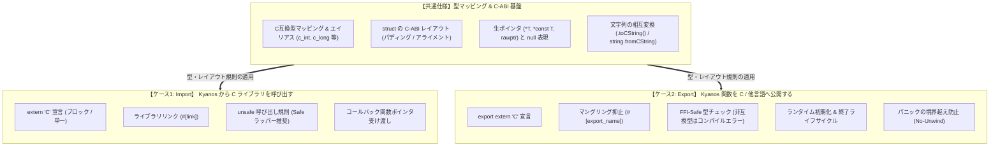

# Kyanos C-FFI 設計仕様書 (Foreign Function Interface Specification)

## 1. 基本方針 & 全体アーキテクチャ (Overview & Philosophy)

Kyanos はシステムプログラミング言語として、既存の膨大な C/C++ 資産（OS API、ハードウェア制御、グラフィックス、DBドライバ等）とオーバーヘッドなし（ゼロコスト）で連携できることを最重要要件の一つとする。

FFI は大きく分けて以下の **2大ユースケース** に分離して設計する：



---

## 2. ケース1: Cライブラリの呼び出し (Import: Calling C from Kyanos)

外部の C ライブラリで定義された関数・グローバル変数を Kyanos から呼び出す機能。

### 2.1 宣言構文 (extern "C" ブロック & 単一宣言 & 可変長引数)

C 言語の関数宣言は `extern "C"` ブロック、または単一の `extern "C"` 宣言を使用する。本体ブロック `{ ... }` を持たず、シグネチャのみを記述する。

* **C 可変長引数 (`...`) のサポート**:
  - `printf` や `snprintf`, `ioctl` などの C 可変長引数関数は、仮引数リストの末尾に `...` を記述して宣言・呼び出し可能。
  - 可変長引数部分には FFI-Safe な型のみ渡すことができ、呼び出し時には C 言語の既定の実引数拡張（Default Argument Promotions: `float` $\to$ `double`、`byte` / `short` / `bool` $\to$ `int`）がコンパイラにより自動適用される。

```typescript
// 1. Bulk declaration via extern "C" block (including variadic function)
extern "C" {
    function puts(s: *const ubyte): int
    function printf(fmt: *const ubyte, ...): int
    function malloc(size: size_t): rawptr
    function free(ptr: rawptr): void
    function sqrt(x: double): double
}

// 2. Compact single function declaration
extern "C" function abs(x: int): int
```

### 2.2 ライブラリのリンク指定 & シンボル名マッピング

リンク対象の静的/動的ライブラリおよび C 側の実シンボル名を属性（Attributes）で指定する。

* **`#[link(name = "...")]`**: リンクするライブラリ名を指定（`-l<name>` に相当）。ブロック全体または個別関数に付与可能。
* **`#[link_name = "..."]`**: C 側のシンボル名と Kyanos 側の関数名が異なる場合に、C側の物理シンボル名を明示。

```typescript
// Link against sqlite3 library
#[link(name = "sqlite3")]
extern "C" {
    // Referenced as `sqliteOpen` in Kyanos, resolved to `sqlite3_open` at link time
    #[link_name = "sqlite3_open"]
    function sqliteOpen(filename: *const ubyte, ppDb: *rawptr): int

    #[link_name = "sqlite3_close"]
    function sqliteClose(pDb: rawptr): int
}
```

### 2.3 外部グローバル変数 (External Global Variables)

C ライブラリのグローバル変数（`errno` や `stdin` など）を参照・操作する場合、ブロック内で `let`（可変）または `const`（不変）を用いて宣言する。

```typescript
extern "C" {
    // C の 'extern int errno;' に対応
    let errno: int

    // C の 'extern FILE* stdout;' に対応
    const stdout: rawptr
}

// 利用例
unsafe {
    if (errno != 0) {
        // Handle C errno
    }
}
```

### 2.4 呼び出し規約 (Calling Conventions)

デフォルトは標準の C 呼び出し規約（`"C"` / `cdecl`）。Windows API や特殊なプラットフォーム向けに異なる規約を明示可能。

```typescript
// Windows 32bit / WinAPI 向け stdcall
extern "stdcall" {
    function MessageBoxA(hWnd: rawptr, text: *const ubyte, caption: *const ubyte, uType: uint): int
}

// プラットフォームのシステム標準 (Windows なら stdcall、他は C)
extern "system" {
    function GetCurrentProcessId(): uint
}
```

### 2.5 安全性モデル (Safety Model: unsafe 規則)

C 言語の関数呼び出しはメモリ境界検査がなく、任意のアドレスアクセスやヌルポインタ参照の可能性があるため、**未定義動作 (Undefined Behavior) を引き起こす可能性がある。**

* **`unsafe` 必須**: 外部 `extern` 関数の呼び出しおよび外部可変グローバル変数の読み書きは、必ず `unsafe` ブロック内で行わなければならない（Rust と同様）。
* **Safe ラッパーの推奨**: 外部 C 関数を直接露出させず、Kyanos の Safe な関数・構造体・クラスでラップして型安全な抽象化を提供する。

```typescript
// Direct FFI call requires unsafe
unsafe {
    let ptr = malloc(1024)
    free(ptr)
}

// Recommended: Wrap in a Safe Kyanos function
function safeAllocateBuffer(size: size_t): rawptr {
    if (size == 0) {
        return null
    }
    unsafe {
        let ptr = malloc(size)
        if (ptr == null) {
            panic("Out of memory")
        }
        return ptr
    }
}
```

### 2.6 C コールバックへの Kyanos 関数ポインタ受け渡し & ORC オブジェクト寿命管理

C の API（例: `qsort` や OS イベントリスナー）に関数ポインタを渡す場合：

* **キャプチャなし関数の自動変換**:
  - 外側のスコープの変数をキャプチャしない通常関数、および静的アロー関数は、C の標準関数ポインタ（8バイトのコードポインタ）に暗黙的にキャスト可能。
* **キャプチャありクロージャの禁止**:
  - 状態（環境レコード）をキャプチャするクロージャは 16 バイトの Fat Pointer（コードポインタ + 環境ポインタ）となるため、C の関数ポインタ型に渡そうとすると **コンパイルエラー** となる。
* **ユーザーデータ（Context / Baton）と ORC オブジェクト寿命管理 (`FFI.intoRaw` / `borrowRaw` / `fromRaw`)**:
  - C 側が `void* user_data` を受け取るコールバック API に Kyanos の `class`（ORC 管理オブジェクト）を渡す場合、単なる `obj as rawptr` の直接キャストはスコープ脱出時の即時解放（Use-After-Free）を招くため **コンパイルエラー** とする。
  - 代わりに、標準ライブラリ `std::ffi` の以下の 3 つの明示的ライフサイクル管理 API を使用する：
    1. **`FFI.intoRaw(obj: T): rawptr`**: ORC の参照カウントを `+1`（保持）して自動解放を抑止し、生ポインタ `rawptr` に変換して C 側へ所有権を預ける。
    2. **`FFI.borrowRaw<T>(ptr: rawptr): T` (`unsafe`)**: C のコールバック実行中などに、参照カウントを増減させずに `rawptr` から一時的にクラス参照 `T` を復元してアクセスする。
    3. **`FFI.fromRaw<T>(ptr: rawptr): T` (`unsafe`)**: C 側での利用完了時に呼び出し、預けていた所有権を Kyanos の ORC 管理下へ回収する（戻り値の変数がスコープを抜けた時点で参照カウントが `-1` され解放される）。

```typescript
extern "C" {
    // qsort(void *base, size_t nel, size_t width, int (*compar)(const void *, const void *))
    function qsort(
        base: rawptr,
        nel: size_t,
        width: size_t,
        compar: (a: rawptr, b: rawptr) => int
    ): void
}

// Stateless comparison function (no captures)
function compareInts(a: rawptr, b: rawptr): int {
    unsafe {
        let valA = *(a as *const int)
        let valB = *(b as *const int)
        return valA - valB
    }
}

function sortArray(arr: int[10]) {
    unsafe {
        // compareInts has no captures, so it converts to a C function pointer
        qsort(&arr as rawptr, 10, sizeof(int), compareInts)
    }
}

// Passing an ORC-managed class instance as C user_data
class AppContext {
    count: int = 0
}

// C callback receiving void* user_data
function onEventCallback(userData: rawptr) {
    unsafe {
        // Borrow reference without decrementing ORC refcount
        let ctx = FFI.borrowRaw<AppContext>(userData)
        ctx.count += 1
    }
}

function runEventLoop() {
    let ctx = new AppContext()
    // Increment ORC refcount and convert to rawptr (direct 'ctx as rawptr' is a compile error)
    let rawCtx = FFI.intoRaw(ctx)

    // Reclaim ownership when C side finishes so ORC can deallocate it
    defer unsafe {
        let _reclaimed = FFI.fromRaw<AppContext>(rawCtx)
    }

    // Pass rawCtx and callback to C API...
}
```

---

## 3. ケース2: Kyanos 関数の C への公開 (Export: Exposing Kyanos to C)

Kyanos で実装したロジックを共有ライブラリ（`.dll` / `.so` / `.dylib`）または静的ライブラリとしてビルドし、C/C++、Python、Go、Rust、C# 等の外部ホスト環境から呼び出せるようにする機能。

### 3.1 エクスポート構文 (export extern "C" & 可変長引数関数定義)

外部へ C シンボルとして公開する関数には、`export` と `extern "C"` を同時に付与する。
また、C 側から可変長引数（`...`）を受け取る関数を定義する場合は、末尾の引数に組み込みの `VaList` 型（`...args: VaList`）を指定し、`unsafe` ブロック内で `args.next<T>()` を呼び出して引数を順次取得する（LLVM の `va_start` / `va_arg` / `va_end` イントリンシックに展開され、スコープ終了時に自動で `va_end` が呼ばれる）。

```typescript
// Export as C symbol `kyanos_add`
export extern "C" function kyanos_add(a: int, b: int): int {
    return a + b
}

// Export a C-compatible variadic function
export extern "C" function kyanos_sum_ints(count: int, ...args: VaList): int {
    let total = 0
    for (let i = 0; i < count; i += 1) {
        unsafe {
            total += args.next<int>()
        }
    }
    return total
}
```

### 3.2 シンボル名とマングリング抑止

* **デフォルト動作**:
  - `export extern "C"` を付与した関数は、モジュール名前空間による**名前マングリング（Name Mangling）が自動的に無効化**され、関数名がそのままシンボル名（例: `kyanos_add`）としてバイナリのエクスポートテーブルに出力される。
* **`#[export_name = "..."]`**:
  - ソースコード上の識別子とは異なる任意のシンボル名でエクスポートしたい場合に指定する。

```typescript
// Kyanos コード内では `multiply`、C 側からは `MyLib_Multiply` として参照可能
#[export_name = "MyLib_Multiply"]
export extern "C" function multiply(a: double, b: double): double {
    return a * b
}
```

### 3.3 シグネチャの制約 (FFI-Safe 型チェック)

C 言語には Kyanos の高度なランタイム概念（ORC管理クラス、動的配列ヘッダ、フレキシブル文字列、判別共用体など）が存在しない。
したがって、`export extern "C"` 関数の引数および戻り値には、**C-ABI 互換な型（FFI-Safe Types）のみ** が許可され、非互換な型を指定した場合は **コンパイルエラー** とする。

| 許可される型 (FFI-Safe) | 説明 |
| :--- | :--- |
| **プリミティブ型** | `int`, `double`, `bool`, `size_t` 等の固定サイズ数値型 |
| **C 互換型エイリアス** | `c_int`, `c_long`, `c_char` 等 |
| **生ポインタ** | `*T` (可変), `*const T` (不変), `rawptr` (`void*`) |
| **C 互換構造体 (`struct`)** | C レイアウトを持つ値型構造体（`#[repr(union)] struct` を含む） |
| **構造体内の固定長配列 (`T[N]`)** | `struct` フィールドとしてインライン展開される固定長配列 |
| **単純な数値列挙型 (`enum`)** | ペイロードを持たない数値 `enum`（デフォルトは `int` (32bit)、`enum Flags : uint` のように基底整数型の明示も可） |
| **C 互換関数ポインタ** | キャプチャなしの関数ポインタシグネチャ |

| 禁止される型 (コンパイルエラー) | 理由・代替案 |
| :--- | :--- |
| **`string`** | ORC管理ヒープオブジェクトのため。`*const ubyte` (C文字列) を使用する |
| **動的配列 `T[]`** | `length`/`capacity` ヘッダを持つため。`*const T` と `size_t len` に分解して渡す |
| **引数・戻り値での固定長配列 `T[N]`** | C言語のポインタ退化と Kyanos の値コピーの混同を防ぐため。`extern "C"` 関数の引数・戻り値では `*T` / `*const T` を使用する |
| **クラス (`class`)** | ORC参照カウンタおよび vtable を持つため。`FFI.intoRaw(obj)` で不透明ポインタ `rawptr` に変換して渡す |
| **ペイロード付き `enum` (`Result` / `Option` 等)** | タグ付き共用体のため（ただし `Option<*T>` は NULL ポインタ最適化により例外的に許可）。エラーコード整数値や出力引数ポインタで表現する |

```typescript
// ❌ コンパイルエラー例
export extern "C" function badFunction(s: string, arr: int[]): Result<int, string> { ... }

// ⭕ Correct C-ABI compatible declaration
export extern "C" function goodFunction(
    s: *const ubyte,     // C string (immutable pointer)
    arr: *const int,     // Array head pointer (immutable pointer)
    len: size_t,         // Array length
    outResult: *int      // Output parameter (mutable pointer)
): int {                 // Error code (0: success, others: error)
    if (s == null || arr == null || outResult == null) {
        return -1
    }
    unsafe {
        *outResult = 42
    }
    return 0
}
```

### 3.4 ランタイム初期化 & 終了ライフサイクル (DLL / .so 連携)

Kyanos のコードを実行するためには、スレッド局所 ORC ヒープや循環参照コレクタなどのランタイム基盤が準備されている必要がある。

1. **共有ライブラリ (.dll / .so) の自動初期化**:
   - コンパイラは共有ライブラリ生成時、プラットフォーム標準のエントリポイント（Windows の `DllMain`、Linux/macOS の `__attribute__((constructor))`）を自動生成し、プロセスタスクロード時に Kyanos ランタイムの基本初期化を行う。
2. **外部スレッドからの呼び出し (スレッド局所記憶 / TLS: Thread Local Storage の遅延初期化)**:
   - C 側の任意のスレッドからエクスポート関数が呼び出された場合、そのスレッドのローカル環境（ORC スレッドヒープ等のコンテキスト）が未初期化であれば、関数エントリ時に自動で遅延初期化（Lazy Initialization）される。
3. **明示的な初期化・終了 API の提供**:
   - 埋め込み環境向けに、標準のライフサイクル制御関数が自動エクスポートされる：
     ```c
     // C 側からの呼び出し例
     void kyanos_runtime_init(void);
     void kyanos_runtime_shutdown(void);
     ```

### 3.5 パニック/エラーの境界保護 (No-Unwind Boundary)

Kyanos の関数内で回復不能なパニック（ゼロ除算、配列範囲外アクセス、明示的な `panic()`）が発生した場合：

* **スタック巻き戻しの境界越え禁止**:
  - Kyanos のパニックが C 側のスタックフレームを越えて巻き戻る（Unwind）ことは **未定義動作** となるため禁止する。
* **挙動**:
  - `export extern "C"` の境界でパニックが発生した場合、コンパイラが暗黙に挿入するガード節により捕捉され、標準エラー出力にエラーメッセージとスタックトレースを出力した後、安全にプロセスを即時停止（`abort()`）する。
  - エラーをホスト側に伝えたい場合は、必ず C の慣例に従い、関数の戻り値（エラーコード整数値）として処理する。

---

## 4. 共通仕様: 型マッピング & C-ABI (Common ABI Foundation)

### 4.1 プリミティブ型対応表

| C 言語の型 | Kyanos 型 | サイズ (バイト) | 備考 |
| :--- | :--- | :--- | :--- |
| `int8_t` / `char` (signed) | `byte` (`i8`) | 1 | 符号付き 8bit 整数 |
| `uint8_t` / `unsigned char` | `ubyte` (`u8`) | 1 | 符号なし 8bit 整数 (バイナリバッファ) |
| `int16_t` / `short` | `short` (`i16`) | 2 | 符号付き 16bit 整数 |
| `uint16_t` / `unsigned short` | `ushort` (`u16`)| 2 | 符号なし 16bit 整数 |
| `int32_t` / `int` | `int` (`i32`) | 4 | 符号付き 32bit 整数 |
| `uint32_t` / `unsigned int` | `uint` (`u32`) | 4 | 符号なし 32bit 整数 |
| `int64_t` / `long long` | `long` (`i64`) | 8 | 符号付き 64bit 整数 |
| `uint64_t` / `unsigned long long` | `ulong` (`u64`)| 8 | 符号なし 64bit 整数 |
| `size_t` | `size_t` | ポインタ幅 (4 or 8) | アドレス・要素数用符号なし整数 |
| `intptr_t` | `isize` | ポインタ幅 (4 or 8) | ポインタ幅符号付き整数 |
| `float` | `float` (`f32`) | 4 | 単精度浮動小数点数 |
| `double` | `double` (`f64`) | 8 | 倍精度浮動小数点数 |
| `bool` (`_Bool`) | `bool` | 1 | 真偽値 (`true`=1, `false`=0) |
| `void*` | `rawptr` | ポインタ幅 (4 or 8) | 任意の型を指す汎用生ポインタ |
| `T*` | `*T` | ポインタ幅 (4 or 8) | 可変生ポインタ |
| `const T*` | `*const T` | ポインタ幅 (4 or 8) | 不変生ポインタ |
| `void` (戻り値) | `void` | 0 | 戻り値なし |

#### プラットフォーム依存型エイリアス (C Compatibility Types)

C 言語の `long` は、Windows (LLP64: 32bit) と Linux/macOS (LP64: 64bit) でサイズが異なる。クロスプラットフォームな C バインディングを安全に記述するため、標準ライブラリ `std::ffi` にて以下のエイリアスを提供する：

* `c_char`: プラットフォーム依存の `char`（`byte` または `ubyte`）
* `c_int`: 常に C の `int`（通常 `int32`）
* `c_long`: Windows では `int32`、Linux/macOS 64bit では `int64`
* `c_ulong`: Windows では `uint32`、Linux/macOS 64bit では `uint64`

### 4.2 構造体 (`struct`) のメモリレイアウト・アライメント・タグなし共用体 (`#[repr(union)]`)

Kyanos の値型構造体（`struct`）は、**デフォルトでターゲットプラットフォームの C-ABI 規則に従う（Standard C Layout）**。

* **パディングとアライメント**:
  - フィールド宣言の順序はコンパイラによって並び替えられず、宣言通りの順序で配置される。
  - 各メンバのサイズとアライメント要件に基づき、自動的に適切なパディングバイトが挿入される。
* **レイアウト・アライメント属性**:
  - `#[repr(packed)]`: パディングを一切挿入せずバイト単位で詰め込む（ネットワークパケットやハードウェアレジスタ構造体用）。
  - `#[repr(align(N))]`: 構造体のアライメントを N バイト（2の累乗）に明示指定する。
  - `#[repr(union)]`: **C 言語のタグなし共用体（Untagged Union）** として配置する。
    - すべてのフィールドが同一の開始アドレス（オフセット `0`）を共有し、全体のサイズは最大フィールドのサイズ（＋アライメントパディング）となる。
    - フィールドには FFI-Safe な値型のみ指定可能（ORC 管理型やデストラクタを持つ型はコンパイルエラー）。
    - **安全規則**: フィールドへの書き込みは通常通り行えるが、**フィールドの読み取りはどの型が有効かコンパイラが保証できないため、`unsafe` ブロック内でのみ許可**される。

```typescript
// Binary-compatible with C struct (1:1 layout)
struct CPoint {
    x: int      // 4 bytes
    // (4 bytes padding if next field is 8-byte aligned)
    timestamp: long // 8 bytes
}

// Packed struct (no padding)
#[repr(packed)]
struct IpHeader {
    versionAndIhl: ubyte
    tos: ubyte
    totalLength: ushort
}

// C untagged union via #[repr(union)]
#[repr(union)]
struct EpollData {
    ptr: rawptr
    fd: int
    u32Val: uint
    u64Val: ulong
}

let data = EpollData { fd: 3 }
unsafe {
    // Reading from a #[repr(union)] field requires unsafe
    let fd = data.fd
}
```

### 4.3 生ポインタ (`*T`, `*const T`, `rawptr`) とポインタ演算・添字アクセス

* **`null` リテラル**: 生ポインタには数値の 0（NULL ポインタ）を表す `null` を直接代入・比較可能。
* **参照外し・添字アクセス・ポインタ演算 (`unsafe` 必須)**:
  - 通常の Kyanos コードでは生ポインタの参照外しは禁止されており、`unsafe` ブロック内でのみ以下の操作が許可される：
    1. **単一要素の参照外し (`*ptr`)**: ポインタが指す先の値の読み書き。
    2. **添字アクセス (`ptr[i]`)**: `*(ptr + i)` と等価。C 関数から渡された配列・バッファの先頭ポインタに対して、要素サイズ単位のオフセットで直接読み書きできる。
    3. **ポインタ加減算 (`ptr + i`, `ptr - i`)**: 要素型 `T` のサイズ（`sizeof(T)`）単位でアドレスを前後移動した新しいポインタを返す。
  - ※ `rawptr`（`void*`）は要素サイズが未定義のため、参照外し・添字アクセス・加減算を行う前に具象ポインタ型（`*ubyte`, `*int` 等）へ `as` キャストする必要がある。
* **`Option<*T>` のゼロコスト最適化**:
  - `Option<*T>` は内部的に生ポインタと同じポインタ幅（8バイト）として表現され、`None` は NULL ポインタとしてエンコードされる（Null Pointer Optimization）。

```typescript
let ptr: *int = null

if (ptr == null) {
    println("Pointer is null")
}

let arr: int[4] = [10, 20, 30, 40]
let pArr: *int = &arr as *int

unsafe {
    // 1. Dereference (*ptr)
    println(`First: ${*pArr}`) // 10

    // 2. Pointer indexing (ptr[i])
    pArr[1] = 200
    println(`Second: ${pArr[1]}`) // 200

    // 3. Pointer arithmetic (ptr + i)
    let pThird = pArr + 2
    println(`Third: ${*pThird}`) // 30
}
```

### 4.4 文字列の相互運用 (String Interop)

Kyanos の `string` はフレキシブル内部表現（PEP 393風）と ORC ヒープ管理を持つため、そのままでは C 言語の `const char*`（NUL終端 UTF-8 バイト列）として扱えない。相互運用のための標準変換機構を提供する。

#### 1. Kyanos `string` から C 文字列への変換 (`.toCString(): CString`)
* `.toCString()` は NUL終端（`\0`）が付与された UTF-8 バイト列バッファを生成し、RAII 値型ラッパー **`CString`** を返す。C 関数へ渡す生ポインタ（`*const ubyte`）は `.asPtr()` メソッドで取得する。
* **寿命とダングリングポインタ防止規則**:
  - 変数に束縛した `let cStr = msg.toCString()` は、そのブロックスコープを抜けた際にデストラクタにより自動解放される。
  - `puts(msg.toCString().asPtr())` のように一時式として直接呼び出した場合、一時オブジェクト `CString` の寿命は **その文（Statement）の評価完了時点まで保証** されるため、関数呼び出し中は安全に有効なポインタが維持される。
  - ただし、`let p = msg.toCString().asPtr()` のように一時オブジェクトの `.asPtr()` の結果を変数に代入・保持する記述は、文の終了と同時にダングリングポインタとなるため **コンパイルエラー** として静的に排除される。

```typescript
let message = "Hello from Kyanos!"

// Pattern A: Bound to a local variable (lives until end of block scope)
let cStr = message.toCString()
unsafe {
    puts(cStr.asPtr())
}

// Pattern B: Temporary in function argument (lives until end of statement)
unsafe {
    puts(message.toCString().asPtr()) // OK: safe within the statement
}

// Compile Error: dangling pointer from temporary CString
// let danglingPtr = message.toCString().asPtr()
```

#### 2. C 文字列から Kyanos `string` への変換 (`string.fromCString`)
* C 側から受け取った `const char*`（`*const ubyte`）を読み取り、NUL 終端までの長さを計測した上で、UTF-8 をデコードして新しい Kyanos `string`（ORC管理）をヒープ生成する。

```typescript
extern "C" function getenv(name: *const ubyte): *const ubyte

function getEnvironmentVariable(name: string): string? {
    let cName = name.toCString()
    let resPtr: *const ubyte = unsafe { getenv(cName.asPtr()) }
    if (resPtr == null) {
        return None
    }
    // Validate and copy C string to construct a new Kyanos string
    return Some(string.fromCString(resPtr))
}
```

#### 3. コンパイル時 C 文字列リテラル (`c"..."`)
* 文字列リテラルの先頭に `c` プレフィックスを付けることで、バイナリの `.rodata` セクションに **コンパイラが自動で末尾 NUL 終端（`\0`）を付与して埋め込んだ** 不変バイト列ポインタ（`*const ubyte`）を直接取得できる（実行時オーバーヘッド・ヒープ確保ゼロ）。
* **内部 NUL 文字の禁止**: 意図しない文字列切断バグを防ぐため、`c"..."` リテラルの途中に `\0`（NUL バイト）が含まれている場合は **コンパイルエラー** とする（Rust の `c"..."` リテラルと同等の安全規則）。

```typescript
unsafe {
    // Passed directly to C function with zero allocation (trailing \0 is added automatically)
    puts(c"Fast path string without allocation")
}
```

---

## 5. ベストプラクティス & 実践パターン (Best Practices)

### パターン 1: `defer` による確実なリソース解放

C のアロケーション（`malloc` / `free`）やハンドル解放（`fclose`）は、Kyanos の `defer` 文と組み合わせることで早期リターンやエラー時でもリークを防ぐ。

```typescript
function processFile(path: string): Result<void, string> {
    let cPath = path.toCString()
    let file = unsafe { fopen(cPath.asPtr(), c"rb") }
    if (file == null) {
        return Err("Failed to open file")
    }
    // Always closed when exiting the scope
    defer unsafe { fclose(file) }

    // File processing logic...
    return Ok(())
}
```

### パターン 2: Safe ラッパークラスと `using` 宣言 (RAII)

不透明ポインタ（Handle）を Kyanos の `class` で包み、`Disposable` インターフェースを実装することで、TypeScript 5.2 準拠の `using` 宣言による自動破棄を実現する。

```typescript
interface Disposable {
    dispose(): void
}

class SafeSqliteDb implements Disposable {
    private handle: rawptr

    private constructor(handle: rawptr) {
        this.handle = handle
    }

    public static open(path: string): Result<SafeSqliteDb, int> {
        let handle: rawptr = null
        let cPath = path.toCString()
        let rc = unsafe { sqliteOpen(cPath.asPtr(), &handle) }
        if (rc != 0) {
            return Err(rc)
        }
        return Ok(new SafeSqliteDb(handle))
    }

    public dispose() {
        if (this.handle != null) {
            unsafe { sqliteClose(this.handle) }
            this.handle = null
        }
    }
}

// 利用側: using スコープを抜けると自動で dispose() が呼ばれ、DBハンドルが閉じられる
function execute() {
    using db = try SafeSqliteDb.open("test.db")
    // データベース操作...
}
```
